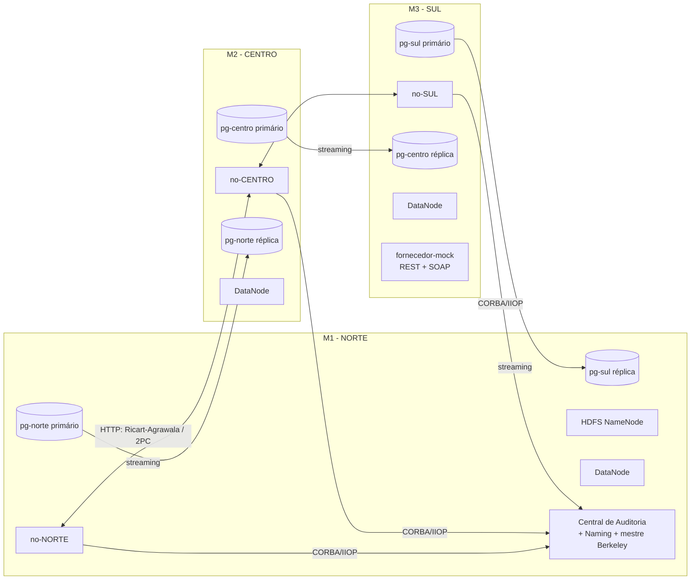

# Notas para o relatório técnico

Registo, por fase, das decisões de design, justificações, diagramas e evidência de testes.
Serve de base para escrever o relatório final (máx. 15 páginas).

---

## Fase 1 — Esqueleto e riscos técnicos

### Arquitectura geral

### Decisões

| Decisão | Justificação |
|---|---|
| Maven multi-módulo (`scad-common`, `scad-no`, `scad-central`) | O código partilhado (stubs CORBA, ORB, cliente HDFS) fica num único sítio. |
| Compilação dentro de Docker (multi-stage, `maven:3.9-eclipse-temurin-17`) | As 3 máquinas compilam da mesma forma, sem instalar JDK nem Maven. A cache `~/.m2` é partilhada entre builds. |
| Uma imagem por serviço (`--target no / central / naming`) a partir de um único Dockerfile | A fase de build é partilhada; as imagens finais só têm o JRE 17. |
| Stubs CORBA gerados no build a partir de `idl/SCAD.idl` (compilador IDL do JacORB) | O IDL é a fonte única da verdade; o código gerado não é versionado. O compilador corre numa JVM separada (`exec:exec`) porque termina com `System.exit()`. |
| `jacorb.ior_proxy_host/port` em vez de `OAIAddr` | Dentro do container não existe o IP da máquina Windows, por isso não é possível fazer *bind* a esse IP. O ORB escuta em todas as interfaces do container numa porta fixa e anuncia no IOR o endereço alcançável (IP da máquina em modo distribuído, nome do serviço em modo local). |
| Registo periódico e idempotente (`rebind` no Naming e `registarAgente` na Central a cada 10 s) | Recupera sozinho de reinícios da Central, do Naming ou do próprio nó, sem estado partilhado. |
| Timeouts de cliente no JacORB (ligação 3 s, resposta 5 s, 1 tentativa) | Uma chamada a um processo morto nunca bloqueia o sistema. |
| Cliente HDFS *shaded* (`hadoop-client-api` + `hadoop-client-runtime`) | As dependências internas do Hadoop ficam isoladas e não entram em conflito com as do Spring Boot. Não foi preciso recorrer ao WebHDFS. |
| `dfs.client.use.datanode.hostname=true` e `dfs.datanode.hostname` por DataNode | O cliente liga-se aos DataNodes por um nome ou IP alcançável, e não pelo IP interno do container. |
| `replace-datanode-on-failure.policy=NEVER` | Com só 3 DataNodes não há substituto no pipeline de escrita; se um cair, a escrita continua com os restantes. |
| Réplica Postgres: `pg_basebackup -R` + slot de replicação físico | `-R` configura `primary_conninfo` e `standby.signal`. O slot garante que o primário guarda o WAL enquanto a réplica estiver desligada. |
| `max_prepared_transactions=50` no primário **e** na réplica | É necessário para o 2PC. Uma réplica precisa de um valor igual ou superior ao do primário, e depois de promovida tem de aceitar `PREPARE TRANSACTION`. |

### Risco técnico: JacORB em Java 17

O Java 11 retirou do JDK tanto o CORBA (`org.omg.*`) como o RMI-IIOP (`javax.rmi.CORBA`).

1. `org.omg.*` vem do jar `jacorb-omgapi`.
2. A primeira execução falhou com `ClassNotFoundException: javax.rmi.CORBA.Stub`: a classe base das referências do JacORB (`org.jacorb.orb.Reference`) estende `javax.rmi.CORBA.Stub`.
3. Juntámos a API `javax.rmi.CORBA` através do jar `yoko-rmi-spec` (Apache), excluindo o `org.omg.*` da Yoko para não duplicar classes.
4. A segunda execução falhou porque o `Stub` exige implementações ("delegates") de `Util` e `Stub`, que no Java 8 vinham do JDK. Criámos `UtilDelegateMinimo` e `StubDelegateMinimo` (pacote `common.corba.rmi`), registados pelas propriedades `javax.rmi.CORBA.UtilClass/StubClass`. São suficientes porque o SCAD só usa IDL (structs, sequences, enums, excepções) e nunca RMI-IIOP (valuetypes). As operações de RMI-IIOP falham explicitamente com `NO_IMPLEMENT`.

Resultado: o JacORB 3.9 funciona em Java 17 sem mudar para Java 8.

### Evidência de testes (Fase 1)

- **JUnit** `ServidorCorbaTest`: chamada IIOP real entre dois ORBs, com propagação da excepção `ProdutoInexistente`.
- **CORBA entre containers:** os 3 agentes registaram-se no Naming e na Central; a Central fez *callback* (`obterRelogio`, `consultarTodos`) a cada agente; `POST /api/prova/alerta` foi entregue (oneway).
- **Resiliência CORBA:** com a Central parada, os nós passam a `centralDisponivel=false`. Com a Central reiniciada, todos voltam a registar-se em ≤ 10 s. Com um nó reiniciado, regista-se de novo sozinho.
- **HDFS:** 3 DataNodes vivos; os ficheiros escritos por cada nó têm `Live_repl=3` (`hdfs fsck`).
- **Postgres:** `pg_stat_replication` mostra `streaming` nos 3 primários; as réplicas têm `pg_is_in_recovery()=t` e vêem os dados escritos no primário.
- **Memória (modo local, tudo num PC):** cerca de 2,1 GB no total (NameNode 345 MB, cada DataNode 250 MB, cada nó 200 MB, cada Postgres 25–50 MB).
