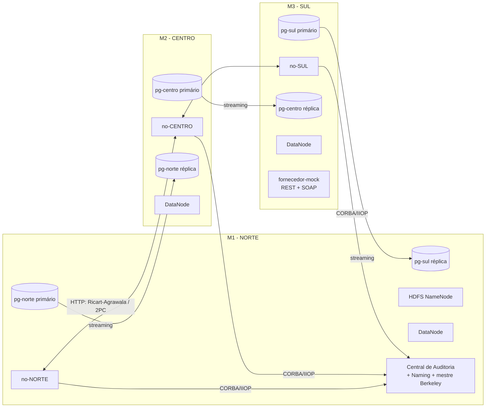

# Notas para o relatório técnico

Registo, por fase, das decisões de design, justificações, diagramas e evidência de testes.
Serve de base para escrever o relatório final (máx. 15 páginas).

---

## Fase 1 — Esqueleto e riscos técnicos

### Arquitectura geral

### Decisões

| Decisão | Justificação |
|---|---|
| Maven multi-módulo (`scad-common`, `scad-no`, `scad-central`) | O código partilhado (stubs CORBA, ORB, cliente HDFS) fica num único sítio. |
| Compilação dentro de Docker (multi-stage, `maven:3.9-eclipse-temurin-17`) | As 3 máquinas compilam da mesma forma, sem instalar JDK nem Maven. A cache `~/.m2` é partilhada entre builds. |
| Uma imagem por serviço (`--target no / central / naming`) a partir de um único Dockerfile | A fase de build é partilhada; as imagens finais só têm o JRE 17. |
| Stubs CORBA gerados no build a partir de `idl/SCAD.idl` (compilador IDL do JacORB) | O IDL é a fonte única da verdade; o código gerado não é versionado. O compilador corre numa JVM separada (`exec:exec`) porque termina com `System.exit()`. |
| `jacorb.ior_proxy_host/port` em vez de `OAIAddr` | Dentro do container não existe o IP da máquina Windows, por isso não é possível fazer *bind* a esse IP. O ORB escuta em todas as interfaces do container numa porta fixa e anuncia no IOR o endereço alcançável (IP da máquina em modo distribuído, nome do serviço em modo local). |
| Registo periódico e idempotente (`rebind` no Naming e `registarAgente` na Central a cada 10 s) | Recupera sozinho de reinícios da Central, do Naming ou do próprio nó, sem estado partilhado. |
| Timeouts de cliente no JacORB (ligação 3 s, resposta 5 s, 1 tentativa) | Uma chamada a um processo morto nunca bloqueia o sistema. |
| Cliente HDFS *shaded* (`hadoop-client-api` + `hadoop-client-runtime`) | As dependências internas do Hadoop ficam isoladas e não entram em conflito com as do Spring Boot. Não foi preciso recorrer ao WebHDFS. |
| `dfs.client.use.datanode.hostname=true` e `dfs.datanode.hostname` por DataNode | O cliente liga-se aos DataNodes por um nome ou IP alcançável, e não pelo IP interno do container. |
| `replace-datanode-on-failure.policy=NEVER` | Com só 3 DataNodes não há substituto no pipeline de escrita; se um cair, a escrita continua com os restantes. |
| Réplica Postgres: `pg_basebackup -R` + slot de replicação físico | `-R` configura `primary_conninfo` e `standby.signal`. O slot garante que o primário guarda o WAL enquanto a réplica estiver desligada. |
| `max_prepared_transactions=50` no primário **e** na réplica | É necessário para o 2PC. Uma réplica precisa de um valor igual ou superior ao do primário, e depois de promovida tem de aceitar `PREPARE TRANSACTION`. |

### Risco técnico: JacORB em Java 17

#### O problema

O **JEP 320 (Java 11)** retirou do JDK os módulos `java.corba` e `java.xml.ws`. Com eles saíram:

- o **CORBA**: os pacotes `org.omg.CORBA`, `org.omg.PortableServer`, `org.omg.CosNaming`, …, e o ORB do próprio JDK;
- o **RMI-IIOP**: os pacotes `javax.rmi` e `javax.rmi.CORBA` e as suas implementações (`com.sun.corba.se.impl.javax.rmi.CORBA.Util`, `StubDelegateImpl`).

O JacORB 3.9 (2017) foi escrito para Java 6–8 e assume que o JDK fornece as duas coisas. Os obstáculos apareceram por camadas:

1. **`org.omg.*` em falta.** Resolve-se com o jar `jacorb-omgapi`, que o próprio JacORB publica.
2. **`ClassNotFoundException: javax.rmi.CORBA.Stub`** ao activar o primeiro servant (`POA.servant_to_reference`). A causa é que a classe base de *todas* as referências do JacORB, `org.jacorb.orb.Reference`, estende `javax.rmi.CORBA.Stub`. Mesmo sem usar RMI-IIOP, a classe tem de existir.
3. **`INITIALIZE: Can not create Util delegate`.** Ao adicionar a API `javax.rmi.CORBA`, o inicializador estático de `Stub` procura uma implementação de `javax.rmi.CORBA.UtilDelegate`, e cada construtor de `Stub` procura uma `StubDelegate`. No Java 8 essas implementações vinham do JDK; aqui não existem.

#### A solução

| Peça | Origem | Papel |
|---|---|---|
| `jacorb-omgapi` 3.9 | JacORB | API `org.omg.*` |
| `yoko-rmi-spec` 1.0, **excluindo** `yoko-spec-corba` | Apache Yoko | Só a API `javax.rmi` / `javax.rmi.CORBA`. A exclusão evita uma segunda cópia de `org.omg.*` no classpath, o que causaria conflitos de classes. |
| `UtilDelegateMinimo` | nosso (`common.corba.rmi`) | Implementa `javax.rmi.CORBA.UtilDelegate`: carrega classes e mapeia excepções. |
| `StubDelegateMinimo` | nosso (`common.corba.rmi`) | Implementa `javax.rmi.CORBA.StubDelegate`: `equals/hashCode/toString` delegam no `Delegate` CORBA do objecto, exactamente como em `ObjectImpl`. |
| `CompatibilidadeJava17.activar()` | nosso | Regista os delegates em `javax.rmi.CORBA.UtilClass` e `javax.rmi.CORBA.StubClass`. É chamado no bloco estático de `FabricaOrb`, antes de qualquer ORB existir. O Naming Service recebe as mesmas propriedades por `-D` no Dockerfile. |

Validação: um teste JUnit com uma chamada IIOP real entre dois ORBs (incluindo uma excepção do IDL), e a comunicação nos dois sentidos entre containers (ver evidência mais abaixo).

#### Porque não Java 8

- **Spring Boot 3 exige Java 17.** Com Java 8 nos módulos CORBA, o `scad-no` (que é servidor CORBA *e* serviço Spring) teria de descer para Spring Boot 2.7, que já não tem suporte, ou de se dividir em dois processos ligados por outro mecanismo. Seria mais complexidade e mais pontos de falha.
- **Duas JVMs no mesmo projecto** (8 e 17) obrigariam a duas toolchains e duas imagens base, e impediriam partilhar o `scad-common`.
- **Âmbito reduzido:** a solução são duas classes pequenas e explícitas, com um propósito bem documentado, enquanto a alternativa obrigaria a mudar toda a arquitectura.
- Os JDK 8 são versões antigas, sem as melhorias de segurança e de contentorização (limites de memória do container, etc.) das versões recentes.

#### Limitação

Os delegates são **mínimos**: suportam o CORBA definido por IDL (structs, sequences, enums, excepções, interfaces, `oneway`) e **não suportam RMI-IIOP** (interfaces `java.rmi.Remote` exportadas por IIOP, valuetypes, `PortableRemoteObject`, `Tie`, cópia de objectos). Essas operações falham explicitamente com `org.omg.CORBA.NO_IMPLEMENT("RMI-IIOP não é suportado no SCAD")`, em vez de terem um comportamento silencioso ou errado. Para o SCAD isto não tem impacto, porque o contrato é exclusivamente o `SCAD.idl`. Se no futuro o IDL passar a usar `valuetype`, será preciso uma implementação completa, por exemplo a `yoko-rmi-impl` ou o GlassFish ORB.

### Evidência de testes (Fase 1)

- **JUnit** `ServidorCorbaTest`: chamada IIOP real entre dois ORBs, com propagação da excepção `ProdutoInexistente`.
- **CORBA entre containers:** os 3 agentes registaram-se no Naming e na Central; a Central fez *callback* (`obterRelogio`, `consultarTodos`) a cada agente; `POST /api/prova/alerta` foi entregue (oneway).
- **Resiliência CORBA:** com a Central parada, os nós passam a `centralDisponivel=false`. Com a Central reiniciada, todos voltam a registar-se em ≤ 10 s. Com um nó reiniciado, regista-se de novo sozinho.
- **HDFS:** 3 DataNodes vivos; os ficheiros escritos por cada nó têm `Live_repl=3` (`hdfs fsck`).
- **Postgres:** `pg_stat_replication` mostra `streaming` nos 3 primários; as réplicas têm `pg_is_in_recovery()=t` e vêem os dados escritos no primário.
- **Memória (modo local, tudo num PC):** cerca de 2,1 GB no total (NameNode 345 MB, cada DataNode 250 MB, cada nó 200 MB, cada Postgres 25–50 MB).
