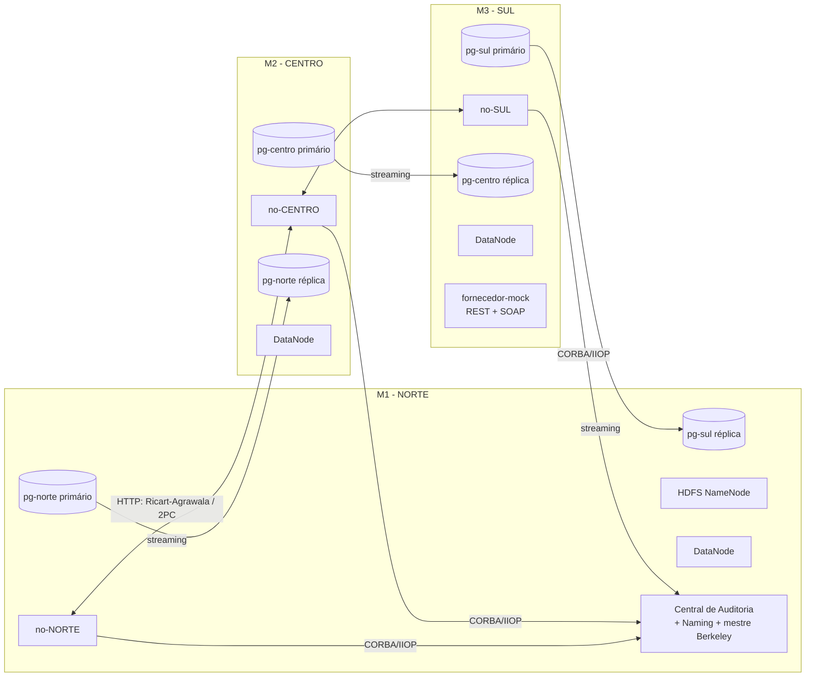
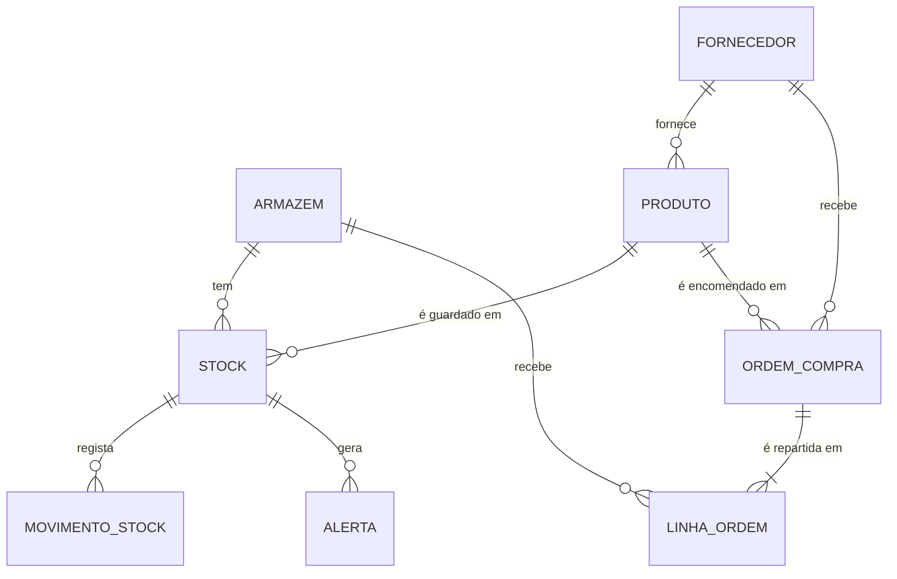
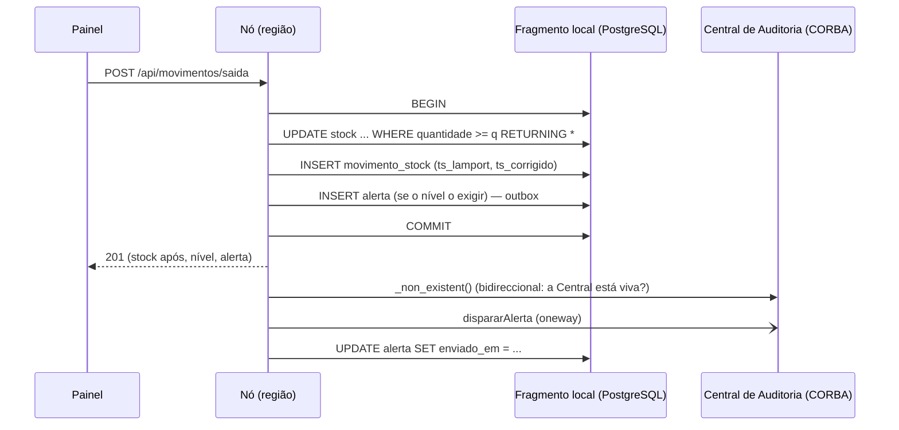

# Notas para o relatório técnico

Registo, por fase, das decisões de design, justificações, diagramas e evidência de testes.
Serve de base para escrever o relatório final (máx. 15 páginas).

---

## Fase 1 — Esqueleto e riscos técnicos

### Arquitectura geral

### Decisões

| Decisão | Justificação |
|---|---|
| Maven multi-módulo (`scad-common`, `scad-no`, `scad-central`) | O código partilhado (stubs CORBA, ORB, cliente HDFS) fica num único sítio. |
| Compilação dentro de Docker (multi-stage, `maven:3.9-eclipse-temurin-17`) | As 3 máquinas compilam da mesma forma, sem instalar JDK nem Maven. A cache `~/.m2` é partilhada entre builds. |
| Uma imagem por serviço (`--target no / central / naming`) a partir de um único Dockerfile | A fase de build é partilhada; as imagens finais só têm o JRE 17. |
| Stubs CORBA gerados no build a partir de `idl/SCAD.idl` (compilador IDL do JacORB) | O IDL é a fonte única da verdade; o código gerado não é versionado. O compilador corre numa JVM separada (`exec:exec`) porque termina com `System.exit()`. |
| `jacorb.ior_proxy_host/port` em vez de `OAIAddr` | Dentro do container não existe o IP da máquina Windows, por isso não é possível fazer *bind* a esse IP. O ORB escuta em todas as interfaces do container numa porta fixa e anuncia no IOR o endereço alcançável (IP da máquina em modo distribuído, nome do serviço em modo local). |
| Registo periódico e idempotente (`rebind` no Naming e `registarAgente` na Central a cada 10 s) | Recupera sozinho de reinícios da Central, do Naming ou do próprio nó, sem estado partilhado. |
| Timeouts de cliente no JacORB (ligação 3 s, resposta 5 s, 1 tentativa) | Uma chamada a um processo morto nunca bloqueia o sistema. |
| Cliente HDFS *shaded* (`hadoop-client-api` + `hadoop-client-runtime`) | As dependências internas do Hadoop ficam isoladas e não entram em conflito com as do Spring Boot. Não foi preciso recorrer ao WebHDFS. |
| `dfs.client.use.datanode.hostname=true` e `dfs.datanode.hostname` por DataNode | O cliente liga-se aos DataNodes por um nome ou IP alcançável, e não pelo IP interno do container. |
| `replace-datanode-on-failure.policy=NEVER` | Com só 3 DataNodes não há substituto no pipeline de escrita; se um cair, a escrita continua com os restantes. |
| Réplica Postgres: `pg_basebackup -R` + slot de replicação físico | `-R` configura `primary_conninfo` e `standby.signal`. O slot garante que o primário guarda o WAL enquanto a réplica estiver desligada. |
| `max_prepared_transactions=50` no primário **e** na réplica | É necessário para o 2PC. Uma réplica precisa de um valor igual ou superior ao do primário, e depois de promovida tem de aceitar `PREPARE TRANSACTION`. |

### Risco técnico: JacORB em Java 17

#### O problema

O **JEP 320 (Java 11)** retirou do JDK os módulos `java.corba` e `java.xml.ws`. Com eles saíram:

- o **CORBA**: os pacotes `org.omg.CORBA`, `org.omg.PortableServer`, `org.omg.CosNaming`, …, e o ORB do próprio JDK;
- o **RMI-IIOP**: os pacotes `javax.rmi` e `javax.rmi.CORBA` e as suas implementações (`com.sun.corba.se.impl.javax.rmi.CORBA.Util`, `StubDelegateImpl`).

O JacORB 3.9 (2017) foi escrito para Java 6–8 e assume que o JDK fornece as duas coisas. Os obstáculos apareceram por camadas:

1. **`org.omg.*` em falta.** Resolve-se com o jar `jacorb-omgapi`, que o próprio JacORB publica.
2. **`ClassNotFoundException: javax.rmi.CORBA.Stub`** ao activar o primeiro servant (`POA.servant_to_reference`). A causa é que a classe base de *todas* as referências do JacORB, `org.jacorb.orb.Reference`, estende `javax.rmi.CORBA.Stub`. Mesmo sem usar RMI-IIOP, a classe tem de existir.
3. **`INITIALIZE: Can not create Util delegate`.** Ao adicionar a API `javax.rmi.CORBA`, o inicializador estático de `Stub` procura uma implementação de `javax.rmi.CORBA.UtilDelegate`, e cada construtor de `Stub` procura uma `StubDelegate`. No Java 8 essas implementações vinham do JDK; aqui não existem.

#### A solução

| Peça | Origem | Papel |
|---|---|---|
| `jacorb-omgapi` 3.9 | JacORB | API `org.omg.*` |
| `yoko-rmi-spec` 1.0, **excluindo** `yoko-spec-corba` | Apache Yoko | Só a API `javax.rmi` / `javax.rmi.CORBA`. A exclusão evita uma segunda cópia de `org.omg.*` no classpath, o que causaria conflitos de classes. |
| `UtilDelegateMinimo` | nosso (`common.corba.rmi`) | Implementa `javax.rmi.CORBA.UtilDelegate`: carrega classes e mapeia excepções. |
| `StubDelegateMinimo` | nosso (`common.corba.rmi`) | Implementa `javax.rmi.CORBA.StubDelegate`: `equals/hashCode/toString` delegam no `Delegate` CORBA do objecto, exactamente como em `ObjectImpl`. |
| `CompatibilidadeJava17.activar()` | nosso | Regista os delegates em `javax.rmi.CORBA.UtilClass` e `javax.rmi.CORBA.StubClass`. É chamado no bloco estático de `FabricaOrb`, antes de qualquer ORB existir. O Naming Service recebe as mesmas propriedades por `-D` no Dockerfile. |

Validação: um teste JUnit com uma chamada IIOP real entre dois ORBs (incluindo uma excepção do IDL), e a comunicação nos dois sentidos entre containers (ver evidência mais abaixo).

#### Porque não Java 8

- **Spring Boot 3 exige Java 17.** Com Java 8 nos módulos CORBA, o `scad-no` (que é servidor CORBA *e* serviço Spring) teria de descer para Spring Boot 2.7, que já não tem suporte, ou de se dividir em dois processos ligados por outro mecanismo. Seria mais complexidade e mais pontos de falha.
- **Duas JVMs no mesmo projecto** (8 e 17) obrigariam a duas toolchains e duas imagens base, e impediriam partilhar o `scad-common`.
- **Âmbito reduzido:** a solução são duas classes pequenas e explícitas, com um propósito bem documentado, enquanto a alternativa obrigaria a mudar toda a arquitectura.
- Os JDK 8 são versões antigas, sem as melhorias de segurança e de contentorização (limites de memória do container, etc.) das versões recentes.

#### Limitação

Os delegates são **mínimos**: suportam o CORBA definido por IDL (structs, sequences, enums, excepções, interfaces, `oneway`) e **não suportam RMI-IIOP** (interfaces `java.rmi.Remote` exportadas por IIOP, valuetypes, `PortableRemoteObject`, `Tie`, cópia de objectos). Essas operações falham explicitamente com `org.omg.CORBA.NO_IMPLEMENT("RMI-IIOP não é suportado no SCAD")`, em vez de terem um comportamento silencioso ou errado. Para o SCAD isto não tem impacto, porque o contrato é exclusivamente o `SCAD.idl`. Se no futuro o IDL passar a usar `valuetype`, será preciso uma implementação completa, por exemplo a `yoko-rmi-impl` ou o GlassFish ORB.

### Evidência de testes (Fase 1)

- **JUnit** `ServidorCorbaTest`: chamada IIOP real entre dois ORBs, com propagação da excepção `ProdutoInexistente`.
- **CORBA entre containers:** os 3 agentes registaram-se no Naming e na Central; a Central fez *callback* (`obterRelogio`, `consultarTodos`) a cada agente; `POST /api/prova/alerta` foi entregue (oneway).
- **Resiliência CORBA:** com a Central parada, os nós passam a `centralDisponivel=false`. Com a Central reiniciada, todos voltam a registar-se em ≤ 10 s. Com um nó reiniciado, regista-se de novo sozinho.
- **HDFS:** 3 DataNodes vivos; os ficheiros escritos por cada nó têm `Live_repl=3` (`hdfs fsck`).
- **Postgres:** `pg_stat_replication` mostra `streaming` nos 3 primários; as réplicas têm `pg_is_in_recovery()=t` e vêem os dados escritos no primário.
- **Memória (modo local, tudo num PC):** cerca de 2,1 GB no total (NameNode 345 MB, cada DataNode 250 MB, cada nó 200 MB, cada Postgres 25–50 MB).

---

## Fase 2 — Dados e fluxo base (saída de stock → alerta CORBA)

### Modelo da base de dados distribuída

| Tabela | Distribuição | Justificação |
|---|---|---|
| `armazem`, `fornecedor`, `produto` | **replicada** (igual em todos os fragmentos) | catálogo pequeno e quase estático; lido em todas as operações locais |
| `stock`, `movimento_stock`, `alerta` | **fragmentação horizontal** por região | cada armazém só altera o seu stock: escritas locais, sem coordenação |
| `linha_ordem` | **fragmentação horizontal** por região | cada linha incrementa o `em_encomenda` *desse* armazém: tem de estar no mesmo fragmento que o seu `stock` |
| `ordem_compra` | cabeçalho em **todos os fragmentos que participam** na ordem | o painel vê a ordem mesmo com um nó em baixo; dá ao 2PC um motivo real para tocar vários fragmentos |

**O predicado de fragmentação é imposto pela própria BD.** `db/init/04-fragmento.sh` adiciona `CHECK (armazem_id = '<REGIÃO>')` a cada tabela fragmentada (teste: `fragmentoRecusaLinhasDeOutraRegiao`). O esquema (`02-esquema.sql`) e o catálogo (`03-catalogo.sql`) são os mesmos em todos os fragmentos; só o script de fragmento e o stock inicial (`db/dados/stock-<região>.sql`) dependem da região (`SCAD_REGIAO`).

Restrições de integridade: `CHECK (quantidade >= 0)`, `em_encomenda >= 0`, `maximo > minimo`, `lote > 0`, e os enumerados (`tipo`, `estado`, `nivel`, `protocolo`) com `CHECK ... IN (...)`.

### Fluxo (passos 1 e 2)

### Decisões

| Decisão | Justificação |
|---|---|
| JDBC explícito (`JdbcTemplate`), sem JPA | O SQL fica visível e controlado. O 2PC (Fase 3) precisa de `PREPARE TRANSACTION` em ligações concretas. |
| `FragmentosBd`: um pool Hikari por fragmento, com `initializationFailTimeout=-1` | O nó arranca mesmo com um fragmento em baixo; cada fragmento tem o seu `TransactionTemplate`. Os fragmentos sem endereço configurado são ignorados. |
| Saída atómica: `UPDATE ... WHERE quantidade >= ? RETURNING *` | A verificação e a actualização são uma só instrução, por isso saídas concorrentes nunca deixam o stock negativo (teste: 20 pedidos concorrentes de 10 sobre 105 → exactamente 10 com sucesso). |
| Níveis: RUPTURA (`q = 0`), CRITICO (`q + enc < min`), AVISO (`q + enc ≤ 1,2 × min`), NORMAL | O AVISO coincide com o "perto do mínimo" da regra de repartição; só o CRITICO activa a reposição (Fase 3). Usa aritmética inteira (`5·disp ≤ 6·min`) para evitar erros de vírgula flutuante. |
| Alertas em **outbox** (tabela `alerta`, gravada na mesma transacção do movimento) | O alerta nunca se perde: se o nó cair depois do commit, o alerta continua na BD e é enviado quando o nó voltar. É também a "fila local" pedida para quando a Central cai. |
| Um estado só gera um alerta (`ultimoAlertaDescreve`) | A verificação periódica (30 s) apanha estados que já existiam no arranque (ex.: FARINHA-25 no SUL), sem repetir alertas. |
| Relógio de Lamport retomado a partir do maior `ts_lamport` gravado | Depois de um reinício, os carimbos do nó nunca recuam. |
| Relógio corrigido = sistema + `CLOCK_SKEW_MS` + ajustes Berkeley | Simula desvios (NORTE +2500 ms, CENTRO −1800 ms, SUL +700 ms) sem mexer no relógio do sistema operativo. |
| Erros HTTP em `problem+json` (RFC 9457) | 404 produto inexistente, 409 stock insuficiente, 422 armazém de outro fragmento, 400 validação, 503 BD indisponível. |
| Estado do HDFS verificado em segundo plano (`MonitorHdfs`) | Com o NameNode inacessível, a verificação demora ~6 s, e o painel faz polling a cada segundo. |

### Problema encontrado: `oneway` + IOR transitório = alertas perdidos em silêncio

Num teste em que a Central foi parada e reiniciada, os alertas ficaram marcados como enviados mas **nunca chegaram**. Causa:
1. O RootPOA é *transient*: o *object key* da Central muda a cada arranque.
2. O nó ainda tinha a referência antiga e enviou o alerta antes de o registo ser refeito.
3. `dispararAlerta` é `oneway`: o servidor não pode responder `OBJECT_NOT_EXIST`, por isso o cliente não recebe erro.

Solução em três camadas:
1. **POA persistente** (`LifespanPolicy PERSISTENT` + `IdAssignmentPolicy USER_ID`), com porta e `jacorb.implname` fixos: os IORs da Central e dos agentes **não mudam entre reinícios**.
2. **`_non_existent()` antes do oneway**: uma operação CORBA padrão com resposta, que confirma que o processo está vivo e tem o objecto activo. Só depois se marca o alerta como enviado.
3. **Deduplicação na Central** por `alertaId`: um reenvio nunca é contado duas vezes (entrega *at-least-once* + idempotência ⇒ efeito *exactly-once*).

Evidência: com a Central parada, ficaram 2 alertas pendentes na fila local. A Central foi reiniciada às 22:55:51.6, e os 2 alertas chegaram às 22:55:52, **antes** de o agente se ter voltado a registar (22:56:01). A referência antiga continuou válida.

### Cenários de demonstração nos dados iniciais

| Produto (lote) | NORTE | CENTRO | SUL | Para que serve |
|---|---|---|---|---|
| ARROZ-25 (500) | 105 / mín 100 | 104 / mín 100 | 300 | **Pico simultâneo**: uma saída de 10 no NORTE e no CENTRO deixa os dois abaixo do mínimo |
| FARINHA-25 (400) | 200 | 90 / mín 80 (perto) | **70 / mín 80** | já abaixo do mínimo no arranque; repartição com prioridade 2 (CENTRO perto do mínimo) |
| ACUCAR-10 (400) | 180 | 160 | 85 / mín 80 (perto) | alerta AVISO no arranque |
| OLEO-5 (600) | 100 / mín 60 | 150 | 140 | saída de 45 no NORTE → prioridade 3 e excesso para o armazém que disparou |
| FEIJAO-10, SABAO-BARRA | normais | | | movimentos sem alerta |

### Evidência de testes (Fase 2)

- `mvn verify`: 27 testes, todos verdes.
  - `RelogioLamportTest` (5), `RelogioCorrigidoTest` (2) e `StockTest` (11 casos de nível, condição de reposição e necessidade).
  - `ServicoMovimentosIT` (8), com **PostgreSQL real via Testcontainers, inicializado com os scripts de produção**: carimbos de Lamport e hora corrigida; alerta CRITICO entregue; fila local com a Central em baixo (reenvio pela ordem de emissão); stock insuficiente sem efeitos; produto inexistente e armazém de outro fragmento rejeitados; predicado de fragmentação imposto pela BD; 20 saídas concorrentes; verificação periódica sem alertas repetidos.
- Stack local: os alertas iniciais esperados chegam à Central (FARINHA-25 CRITICO no SUL e 4 AVISO). A API devolve 201/409/422/400 correctamente, e os acentos (UTF-8) são gravados sem problemas.

### Teste de fumo com 2 máquinas (preparado)

Fica em `deploy/fumo/` (ver o README dessa pasta). Ao validar a parte da M1 num só PC, descobriram-se dois requisitos de ambiente, agora documentados:
- Com o **WSL em modo `mirrored`** (`.wslconfig`), o Docker Desktop não publica as portas na placa de rede: elas só ficam acessíveis em `localhost`. É preciso o modo NAT (o padrão).
- Um **PostgreSQL instalado no Windows** ocupa a porta 5432 em `0.0.0.0` e fica com as ligações ao IP da máquina. Tem de ser parado durante a demonstração.
